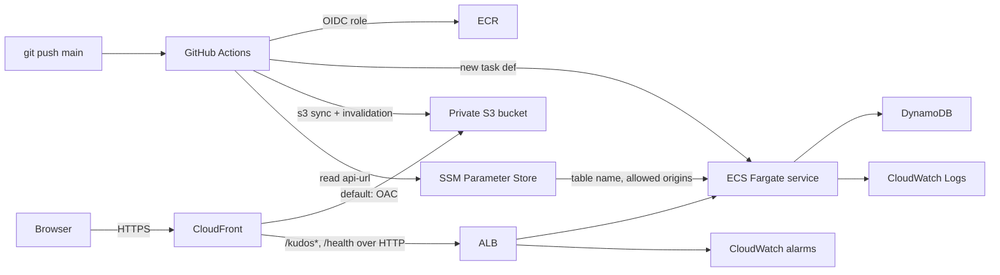

# Project 7: Kudos Board — Checkpoint 2

The Kudos Board is a small public thank-you app built for the [AltSchool Project 7 brief](https://docs.google.com/document/d/1oY5sj65m7mdar7Fp3WSiI-hbV3hb70GFg2ZVsl-uuqU/edit?tab=t.0#heading=h.hjtjddg80460). At Checkpoint 2 both components run on AWS. Terraform in [`infra/`](infra/) provisions all of it, and [GitHub Actions](.github/workflows/deploy.yml) deploys every push to `main` with no console steps.

> **Status: shut down on 14 October 2026.** Everything in `infra/` was removed with `terraform destroy` to stop charges. The GitHub Actions `Deploy` workflow is disabled. Only the Terraform state bucket remains, at near-zero cost. To bring it back, follow [Bring the stack back up](#bring-the-stack-back-up). The site URL, load balancer name and CloudFront ID will all change.

## Deployment at Checkpoint 2 (before shutdown)

**Site URL while live:** https://ds422jrm7fnzg.cloudfront.net (no longer resolves to the app)

| Resource | Value |
| --- | --- |
| AWS account / region | Terracode Analytics `996255343850`, `eu-west-1` |
| Site and API | CloudFront `E2LTOJ3VUES369` → `https://ds422jrm7fnzg.cloudfront.net` |
| Frontend | Private S3 bucket `kudos-site-996255343850-eu-west-1`, read only by CloudFront through Origin Access Control |
| API | ECS Fargate service `kudos-api` on cluster `kudos-cluster`; 1 task with 0.25 vCPU and 512 MiB on port 3000; deployment circuit breaker with rollback |
| Load balancer | `kudos-alb` on HTTP port 80, reachable only from CloudFront's origin-facing IP range; target group `kudos-api-tg` checks `/health` |
| Database | DynamoDB `kudos-kudos`, partition key `id`, on-demand billing, point-in-time recovery |
| Images | ECR `kudos-api`, one image per commit SHA, last 10 kept |
| Config | SSM `/kudos/api-url`, `/kudos/table-name`, `/kudos/allowed-origins` |
| Monitoring | Log group `/ecs/kudos-api` (7 days); alarms `kudos-unhealthy-targets` and `kudos-5xx` → SNS `kudos-alarms` |
| Network | VPC `10.20.0.0/16`, two public subnets, no NAT gateway |
| Terraform state | S3 `kudos-tfstate-996255343850-eu-west-1` (versioned, encrypted, S3-native lock file) |
| CI/CD | GitHub Actions in [adedokuntoluwanimi/kudos-board](https://github.com/adedokuntoluwanimi/kudos-board), assuming `kudos-github-deploy-role` through OIDC |

The Checkpoint 1 resources (`kudos-board-*`, created with the AWS command line) were deleted after the Terraform stack was verified. Their DynamoDB records are saved in [`docs/evidence/checkpoint1-dynamodb-items.json`](docs/evidence/checkpoint1-dynamodb-items.json).

## Architecture

The editable diagram is [`docs/kudos-board-checkpoint2.drawio`](docs/kudos-board-checkpoint2.drawio). Export it as `docs/kudos-board-checkpoint2.png` from draw.io for slides.



**One CloudFront distribution for both components.** The default behavior serves the static site from S3. The `/kudos*` and `/health` behaviors forward to the ALB with caching disabled. The browser therefore calls the API over HTTPS on the same origin as the page. That avoids blocked mixed content (an HTTPS page calling an HTTP-only ALB) without buying a domain or certificate. CORS is still configured for the CloudFront domain, as the spec requires.

**How configuration flows. Nothing is hardcoded.**
- **Backend:**
  - `DYNAMODB_TABLE_NAME` and `ALLOWED_ORIGINS` come from SSM parameters, injected through the task definition's `secrets`.
  - `PORT` and `AWS_REGION` are plain task-definition environment variables.
- **Frontend:** the pipeline reads `/kudos/api-url` from SSM and runs `frontend/write-config.js` to generate `config.js` just before uploading. `config.js` is never committed.

**Why these services:**
- Express keeps the API small.
- DynamoDB with a paginated `Scan` is enough at this scale.
- Fargate runs the container without managing EC2.
- The ALB gives health checks and a stable origin.
- S3 and CloudFront serve the static site privately over HTTPS.
- SSM Parameter Store holds configuration that isn't secret.
- GitHub Actions with OIDC deploys without any stored AWS keys.

## Repository layout

```text
backend/            Express API, Dockerfile, node:test tests
frontend/           Static site; write-config.js generates config.js; dev-server.js for local runs
infra/bootstrap/    One-off Terraform (local state) for the remote-state bucket
infra/              Main Terraform stack (network, alb, ecs, ecr, dynamodb, ssm, frontend, iam, monitoring)
.github/workflows/  deploy.yml: test → backend → frontend
docs/               Diagrams and evidence
```

## Provision with Terraform

You need Terraform 1.10 or newer, and AWS credentials with admin rights in the account.

```powershell
cd infra/bootstrap; terraform init; terraform apply   # once: creates the state bucket
cd ..;              terraform init; terraform apply   # the whole stack
terraform output                                      # values for the GitHub repository variables
```

Notes:
- **First apply:** the task definition points at the image tag `bootstrap`, which doesn't exist yet. The service only becomes healthy after the first pipeline run pushes a real image.
- **Alarm email:** set `alarm_email` in a `terraform.tfvars` file to subscribe an address to alarm notifications (it is not committed).
- **`ignore_changes`:** the ECS service ignores `task_definition` changes, so Terraform never rolls back an image the pipeline deployed. Infrastructure changes to the task definition are picked up on the next pipeline run, which always builds on the latest revision.
- **Deploy role trust:** the role trusts GitHub's immutable OIDC subject for this repo (`repo:adedokuntoluwanimi@203470780/kudos-board@1418083261:ref:refs/heads/main`). New repositories receive that format, and the plain `repo:owner/name` form was rejected with `Not authorized to perform sts:AssumeRoleWithWebIdentity`.

## Bring the stack back up

1. Apply the stack (about 6 minutes, mostly CloudFront):

   ```powershell
   cd infra; terraform init; terraform apply
   ```

   The state bucket from `infra/bootstrap` still exists. If it was deleted, apply `infra/bootstrap` first.
2. Point GitHub at the new resources. The CloudFront ID and the bucket and service names come from the new outputs:

   ```powershell
   $o = terraform output -json | ConvertFrom-Json
   gh variable set CLOUDFRONT_DISTRIBUTION_ID --body $o.distribution_id.value
   gh variable set AWS_DEPLOY_ROLE_ARN --body $o.deploy_role_arn.value
   gh variable set ECR_REPOSITORY_URL --body $o.ecr_repository_url.value
   gh variable set SITE_BUCKET --body $o.site_bucket.value
   ```

   `ECS_CLUSTER`, `ECS_SERVICE`, `ECS_TASK_FAMILY`, `API_URL_PARAMETER` and `AWS_REGION` keep the same values.
3. Re-enable and run the pipeline. The first run pushes a real image; until then the service shows unhealthy.

   ```powershell
   gh workflow enable Deploy
   gh workflow run Deploy
   ```
4. Open the new `site_url` output and post a kudos. The new DynamoDB table starts empty.

To shut it down again, run `terraform destroy` in `infra/` and then `gh workflow disable Deploy`.

## CI/CD pipeline

[`deploy.yml`](.github/workflows/deploy.yml) runs on every push to `main` (docs-only pushes are skipped) and can also be started manually:

1. **`test`:** `npm ci` and `npm test` in `backend/`. A failing test stops the run before anything touches AWS.
2. **`backend`:**
   - assumes the deploy role through OIDC, builds the image and pushes it to ECR tagged with the commit SHA;
   - copies the latest task definition with the new image swapped in and registers it as a new revision;
   - updates the service and waits for it to stabilize.
   
   If the circuit breaker rolls the deployment back, this step fails and the run goes red.
3. **`frontend`:** generates `config.js` from SSM, runs `aws s3 sync` with `--delete` (uploading only `index.html`, `app.js`, `style.css` and `config.js`), and invalidates CloudFront.

The repository variables are `AWS_REGION`, `AWS_DEPLOY_ROLE_ARN`, `ECR_REPOSITORY_URL`, `ECS_CLUSTER`, `ECS_SERVICE`, `ECS_TASK_FAMILY`, `SITE_BUCKET`, `CLOUDFRONT_DISTRIBUTION_ID` and `API_URL_PARAMETER`, all taken from `terraform output`. None of them are secrets, and the repo has no AWS keys.

## Least-privilege IAM

| Role | Can do |
| --- | --- |
| `kudos-ecs-execution-role` | Pull from the `kudos-api` repo only; write to `/ecs/kudos-api` only; `ssm:GetParameters` on the two backend parameters only |
| `kudos-ecs-task-role` | `dynamodb:PutItem` and `dynamodb:Scan` on `kudos-kudos` only |
| `kudos-github-deploy-role` | Assumable only from `main` of this repo. Can push to `kudos-api`, update and describe the `kudos-api` service, pass the two task roles to ECS only, read and write the site bucket, invalidate this distribution, and read `/kudos/api-url` |

Wildcards, and why they are there:
- **`ecr:GetAuthorizationToken`** (both roles), plus **`ecs:RegisterTaskDefinition`** and **`ecs:DescribeTaskDefinition`** (deploy role): AWS does not support resource-level permissions for these actions.
- **Task security group:** allows outbound HTTPS to `0.0.0.0/0`, because tasks reach ECR, SSM, DynamoDB and CloudWatch through public endpoints (there are no VPC endpoints and no NAT).

## Run locally

Use Node.js 20 or newer and AWS credentials allowed to use the table. In PowerShell, from `project-7`:

```powershell
cd backend
npm ci
$env:PORT = '3000'
$env:DYNAMODB_TABLE_NAME = 'kudos-kudos'
$env:AWS_REGION = 'eu-west-1'
$env:ALLOWED_ORIGINS = 'http://localhost:4173'
npm start
```

In a second terminal: `cd frontend; $env:API_URL = 'http://localhost:3000'; node dev-server.js`, then open `http://localhost:4173`.

## API contract

- `GET /health` returns `200 {"status":"ok"}`.
- `GET /kudos` returns `200` and up to 50 items, newest first. Each item has `id`, `from`, `to`, `message`, and an ISO 8601 `timestamp`.
- `POST /kudos` takes JSON `from`, `to` and `message`, and returns `201` with the created item.
  - All three fields must be nonblank strings; `from` and `to` are at most 50 characters, `message` at most 280.
  - Invalid input returns `400 {"error":"<reason>"}`.
  - The server generates `id` and `timestamp`.

## Manual test checklist (Checkpoint 2)

Checked on 13–14 October 2026 against `https://ds422jrm7fnzg.cloudfront.net`, before shutdown:

| Check | Expected | Observed |
| --- | --- | --- |
| `terraform apply` from empty | Whole stack created | Passed: 41 resources added |
| First pipeline run | Green: test, backend, frontend | Passed: run [38480788562](https://github.com/adedokuntoluwanimi/kudos-board/actions/runs/38480788562) |
| `GET /` over HTTPS | `200`, page served from private S3 | Passed |
| `GET /config.js` | API URL injected at deploy time | Passed: `window.KUDOS_API_URL = "https://ds422jrm7fnzg.cloudfront.net"` |
| `GET /health` through CloudFront | `200 {"status":"ok"}` | Passed |
| `POST /kudos`, then `GET /kudos` | `201`; new item listed first | Passed: item `6713f57e-1fd2-4cce-b53d-3ad2b236c4f9` |
| Item persists on reload | Same item still listed | Passed after the later redeploys |
| Invalid `POST /kudos` (empty `from`) | `400` with reason | Passed: `{"error":"from is required."}` |
| CORS for the CloudFront origin | `Access-Control-Allow-Origin` echoes the site | Passed |
| ALB called directly | Blocked (CloudFront IPs only) | Passed: connection timed out |
| S3 object called directly | `403` | Passed |
| Live update through the pipeline | Changed subtitle live without console steps | Passed: run [38481546660](https://github.com/adedokuntoluwanimi/kudos-board/actions/runs/38481546660), about 4.7 minutes from push to live |
| Failure and recovery | Bad deploy rolled back; site stays up; fix redeploys | Passed (see below) |

Run the unit tests with `cd backend; npm test`. They cover the API contract, validation, CORS, and DynamoDB scan pagination.

## Failure demo and recovery runbook

**What broke.** Commit `Failure demo: hardcode the API port` made `server.js` listen on `8080` instead of `PORT`. This is a realistic bug that the unit tests don't catch, because they exercise `createApp` directly rather than `server.js`. The image built and deployed, but the ALB health checks on port 3000 failed.

**What happened** (run [38482136609](https://github.com/adedokuntoluwanimi/kudos-board/actions/runs/38482136609), 14 October, times in UTC+1):
- **00:05:** pushed. Tests passed, the image was pushed, and the service started deployment `0890802937654789115`.
- **00:08, 00:11, 00:14:** ECS drained three failed tasks in turn.
- **00:14:45:** the circuit breaker reported "deployment failed: tasks failed to start" and rolled back to the last good revision.
- The `backend` job failed with "Deployment … not found after stabilization. The deployment was likely rolled back by the deployment circuit breaker." Because of that, the frontend job did not run.
- **Users saw nothing:** with `minimumHealthyPercent = 100`, the old task kept serving the whole time. `GET /health` through CloudFront returned `200` on all 49 probes taken every 15 seconds from 00:05:53 to 00:22:14.

**Recovery.** Commit `Recover: listen on PORT again` was pushed, and run [38483865997](https://github.com/adedokuntoluwanimi/kudos-board/actions/runs/38483865997) deployed task definition revision 5 successfully.

**Monitoring gap found and fixed.** `kudos-unhealthy-targets` originally required two bad minutes in a row. Each failed task was replaced in under two minutes, so the alarm never fired. It now fires on a single minute with an unhealthy target. Re-run the demo to capture the alarm in the `ALARM` state.

**Runbook for a red deploy:**
1. Open the failed Actions run and note the commit.
2. In ECS, check the `kudos-api` service events for "rolling back", then read the stopped task's reason and the `/ecs/kudos-api` logs.
3. Confirm that the site is still being served: `GET https://ds422jrm7fnzg.cloudfront.net/health`.
4. Revert the commit (`git revert <sha>; git push`), or push a fix. The pipeline redeploys.
5. Confirm that the run is green and both alarms show `OK`.

## Cost note (estimate, eu-west-1, always-on)

| Item | Approximate monthly cost |
| --- | --- |
| Application Load Balancer | $18–20 |
| One Fargate task (0.25 vCPU, 0.5 GB) | about $9 |
| Public IPv4 addresses (ALB ×2, task ×1) | about $11 |
| CloudFront, S3, DynamoDB on demand, SSM standard, SNS, ECR, CloudWatch | under $2 at demo traffic |

That is roughly $40 a month. The biggest cost is the ALB plus its public IPv4 addresses. In production, the main cost growth would come from more Fargate tasks and DynamoDB request volume. Running `terraform destroy` in `infra/` removes everything except the state bucket. That was done on 14 October 2026, so the current cost is only the state bucket's few kilobytes in S3.

## Six-week schedule

1. **Week 1:** Build and review both app components; run them with a test DynamoDB table. **Done.**
2. **Week 2:** Draw the architecture, provision the core AWS path by hand, and demo ALB → ECS → DynamoDB. **Done (Checkpoint 1).**
3. **Week 3:** Translate the resources to Terraform; deploy the static frontend on private S3 and CloudFront. **Done.**
4. **Week 4:** Add push-triggered deployment; demonstrate a live update and a failure with recovery. **Done (Checkpoint 2).**
5. **Week 5:** Bring the stack back up (it was shut down after Checkpoint 2), then re-run the failure demo to capture the alarm firing; review IAM, HTTPS and cost; consider stretch goals (staging environment, VPC endpoints).
6. **Week 6:** Final demo, AI-usage write-up, cost note, security review and retrospective.

## What was harder than expected

- **Checkpoint 1:**
  - Docker wasn't available locally, so the first image was built by a one-off CodeBuild project. The first ZIP used Windows path separators, so the Linux build couldn't find `src`.
  - The IAM user can't read the account's primary email.
- **Checkpoint 2:**
  - GitHub now issues OIDC tokens with an immutable subject that includes owner and repo IDs, so the textbook trust condition `repo:owner/name:ref:refs/heads/main` failed. The fix was to read the subject from `gh api repos/OWNER/REPO/actions/oidc/customization/sub` and trust exactly that.
  - An HTTPS CloudFront site can't call an HTTP-only ALB, because browsers block mixed content. Routing `/kudos*` through the same distribution solved it without a domain or certificate.
  - The pipeline and Terraform both want to own the task definition. Terraform ignores `task_definition` on the service, and the pipeline always builds on the latest revision.
  - A port bug that unit tests can't see was the right failure to demonstrate. A broken `/health` would have been stopped by the test job before it reached AWS.
  - A two-minute alarm window was too slow to catch tasks that the circuit breaker replaced every two to three minutes.

## Evidence

- Checkpoint 1 screenshots: `docs/evidence/01`–`06`.
- Checkpoint 2: the GitHub Actions runs linked above, plus [`docs/evidence/checkpoint2-failure-probe.log`](docs/evidence/checkpoint2-failure-probe.log) (site health probes during the failed deploy).
- Still to add as screenshots: the CloudFront site in a browser, the green and red pipeline runs, ECS rollback events, and the alarm in `ALARM`. The stack is shut down, so the site, ECS and alarm screenshots need it brought back up first. The GitHub Actions run pages stay available.
