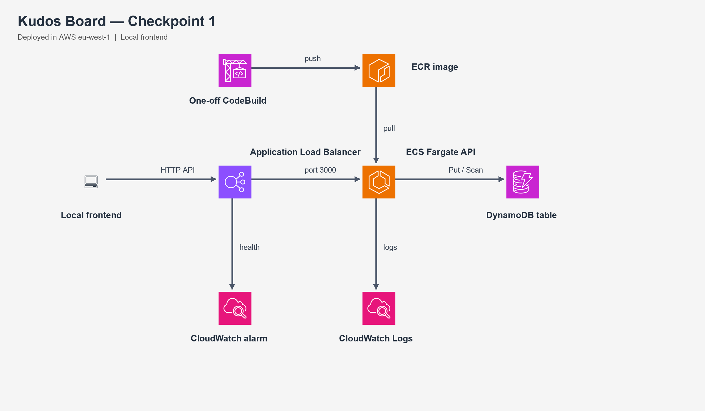

# Project 7: Kudos Board — Checkpoint 1

The Kudos Board is a small public thank-you app built for the [AltSchool Project 7 brief](https://docs.google.com/document/d/1oY5sj65m7mdar7Fp3WSiI-hbV3hb70GFg2ZVsl-uuqU/edit?tab=t.0#heading=h.hjtjddg80460). The API runs locally or on ECS Fargate; the frontend runs locally for Checkpoint 1. DynamoDB holds the kudos.

## Current deployment

| Resource | Value |
| --- | --- |
| AWS account | Terracode Analytics, `996255343850` |
| Region | `eu-west-1` |
| API | `http://kudos-board-alb-2049417382.eu-west-1.elb.amazonaws.com` |
| ECS cluster / service | `kudos-board-checkpoint1` / `kudos-board-api` |
| Task definition | `kudos-board-api:1`, one Fargate task, 0.25 vCPU / 512 MiB |
| DynamoDB table | `kudos-board-checkpoint1`, partition key `id` (string), on-demand billing |
| ECR repository | `kudos-board-api`, image tag `checkpoint-1` |
| ALB / target group | `kudos-board-alb` / `kudos-board-api`, HTTP port 80 → task port 3000; target type `ip`; `/health` check |
| Security groups | `kudos-board-alb-sg` (public port 80), `kudos-board-task-sg` (port 3000 from ALB security group only) |
| IAM | `kudos-board-ecs-execution-role` (ECR pull and logs), `kudos-board-ecs-task-role` (`PutItem` and `Scan` on this table only) |
| Monitoring | `/ecs/kudos-board-api` log group, 7-day retention; `kudos-board-unhealthy-target` alarm |
| Build path | One-off CodeBuild project `kudos-board-image`, using private S3 bucket `kudos-board-build-996255343850-eu-west-1` |

The first AWS resources were created individually with AWS CLI, not through Terraform or a pipeline. **They were not created in the AWS Console.** A console walkthrough of the existing settings and a console-led rebuild are still needed if the assessor interprets “build by hand in the console” literally. CodeBuild was used to build the container because Docker is not installed on the local machine. The deployment is live and accrues AWS charges while running.

## Architecture



The [editable draw.io diagram](docs/kudos-board-checkpoint1.drawio) and its [flow guide](docs/kudos-board-checkpoint1.md) show deployed Checkpoint 1 resources. S3, CloudFront, Terraform, and CI/CD remain later-checkpoint work.

**Why these services:** Express keeps the API small. DynamoDB stores records with a single `id` key; listing scans all pages and sorts by timestamp before returning 50, which is suitable for this small assignment but not a large feed. ECR holds the Docker image; ECS Fargate runs it without EC2 management. The ALB gives a stable entry point and health checks. CloudWatch captures logs and detects unhealthy targets. The eventual frontend will use S3 and CloudFront, with an HTTPS CloudFront endpoint for the API because the Checkpoint 1 ALB URL is HTTP only. The API URL is supplied to the frontend at run or deploy time.

The Fargate task uses a public subnet and public IP so it can pull its image without a NAT gateway. Its security group permits inbound port 3000 only from the ALB security group. No EC2 instance or SSH access is used.

## Run locally

Use Node.js 20 or newer and AWS credentials allowed to use the test DynamoDB table. In PowerShell, from `project-7`:

```powershell
cd backend
npm ci
$env:PORT = '3000'
$env:DYNAMODB_TABLE_NAME = 'kudos-board-checkpoint1'
$env:AWS_REGION = 'eu-west-1'
$env:ALLOWED_ORIGINS = 'http://localhost:4173'
npm start
```

In a second terminal:

```powershell
cd frontend
$env:API_URL = 'http://localhost:3000'
node dev-server.js
```

Open `http://localhost:4173`. To point the local frontend at ECS, set `API_URL` to the ALB URL before starting `dev-server.js`. For static deployment in a later checkpoint, set `API_URL` and run `node frontend/write-config.js` before uploading frontend files. `config.js` is generated and ignored by Git.

## API contract

- `GET /health` → `200 {"status":"ok"}`.
- `GET /kudos` → `200` and an array of up to 50 items, newest first. Each item has `id`, `from`, `to`, `message`, and ISO 8601 `timestamp` strings.
- `POST /kudos` with JSON `from`, `to`, `message` → `201` and the created item. All fields must be nonblank strings; `from` and `to` are at most 50 characters and `message` at most 280. Invalid input → `400 {"error":"<reason>"}`. The server generates `id` and `timestamp`.
- The listening port and table name come from `PORT` and `DYNAMODB_TABLE_NAME`. Browser origins come from comma-separated `ALLOWED_ORIGINS`. The local frontend receives its API URL from `API_URL`.

## Manual test checklist and evidence

Checked on 30 September 2026:

| Check | Expected | Observed |
| --- | --- | --- |
| Local `GET /health` | `200` and `status: ok` | Passed |
| Local `POST /kudos`, then `GET /kudos` | New item appears | Passed; item `3d46a4de-b8b2-43e3-9a4e-660819fc9722` |
| CodeBuild image build | Image pushed to ECR | Passed; digest `sha256:744cbbe8e5809ccfb06129307f54cefac79d2201373b1d142b1b7e3e9234d224` |
| ECS service / ALB target | One running task; healthy target | Passed; service deployment completed, target healthy |
| ALB `GET /health` | `200` and `status: ok` | Passed |
| ALB `POST /kudos`, then `GET /kudos` | Created item is newest | Passed; item `916aaff7-f70e-4b29-a825-5099b7fefa04` |
| ALB invalid `POST /kudos` | `400` | Passed for empty `from` |
| Browser CORS preflight to ALB | Local origin allowed | Passed; `204` and `Access-Control-Allow-Origin: http://localhost:4173` |
| DynamoDB scan | Live item exists | Passed; both local and ALB item IDs found |
| CloudWatch alarm | `OK` while target is healthy | Passed |
| Browser post and validation | New item appears first; invalid message shows inline error | Passed in user screenshots: a new `Tolu → Marvellous` item appears first, and a whitespace-only message shows `message is required.` Refresh persistence remains to be demonstrated live. |

Run the backend tests with `cd backend; npm test`. The tests cover the API contract, validation, CORS, and scan pagination. For a live demo, use the local frontend and show the ALB health endpoint, an API-created kudos item, its DynamoDB record, ECS target health, and the CloudWatch alarm. Preserve your own screenshots for submission.

## Six-week schedule

1. **Week 1:** Build and review both app components; run them with a test DynamoDB table.
2. **Week 2:** Draw architecture, provision the core AWS path manually, demo ALB → ECS → DynamoDB, and discuss issues found.
3. **Week 3:** Translate resources to Terraform; deploy the static frontend on private S3 and CloudFront.
4. **Week 4:** Add push-triggered image and frontend deployment; demonstrate a real live update and an alarm.
5. **Week 5:** Exercise a deployment failure and recovery; review IAM, HTTPS, and cost.
6. **Week 6:** Complete the demo, AI-usage write-up, cost note, security review, and retrospective.

## What was harder than expected

- The local machine had no Docker executable, so a one-off CodeBuild project was needed for the first image. The initial uploaded ZIP used Windows path separators; the Linux build could not find `src`. Repacking it with forward-slash paths fixed the build.
- The AWS account’s IAM user cannot read the account’s primary email. The account ID and displayed account name were matched against the owner’s console screenshot; the email itself remains unverified.
- Automated browser verification was unavailable in the tool session, so browser evidence was captured manually in Chrome. Refresh persistence remains a live-demo check.

## AWS resource lifecycle

The ALB, Fargate task, DynamoDB table, and other resources are live. Stop or remove them after the checkpoint if no longer needed to avoid ongoing charges. Keep the DynamoDB table if its test records are needed for evidence. Do not remove resources while preparing the live demo.
